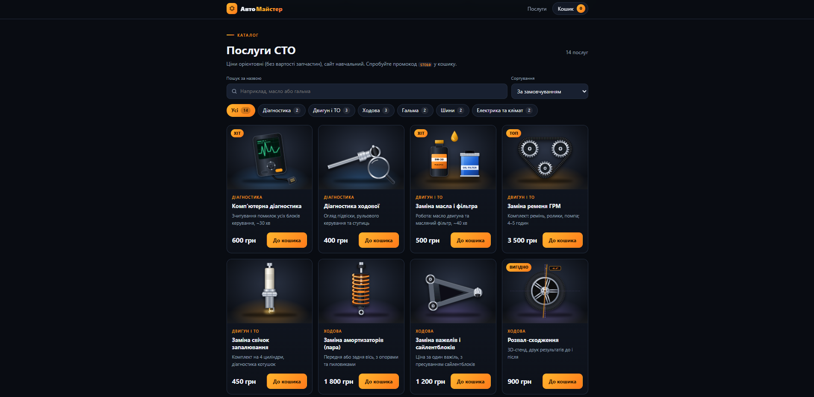

# АвтоМайстер — каталог послуг СТО на Vue 3

Навчальний проєкт (КП № 2): каталог послуг станції технічного обслуговування (СТО) з реактивним кошиком і записом на візит.

**Тема:** СТО «АвтоМайстер» (діагностика, двигун і ТО, ходова, гальма, шини, електрика та клімат).



## Як запустити

```bash
npm install
npm run dev
```

Сайт відкриється за адресою, яку покаже Vite (зазвичай http://localhost:5173).

Збірка для публікації:

```bash
npm run build
npm run preview
```

## Що реалізовано

| Вимога | Де в коді |
| --- | --- |
| Каталог із 14 послуг (назва, ціна, зображення, категорія), дані з JSON через `fetch` | `public/products.json`, `loadProducts()` в `src/App.vue` |
| Фільтр за категорією і пошук за назвою через `computed` | `filteredProducts` в `src/App.vue` |
| Кошик: додати, змінити кількість (+ / −), видалити; лічильник у шапці і сума оновлюються одразу | `cart`, `cartItems`, `cartCount`, `cartTotal` в `src/App.vue` |
| Власні компоненти з props і emit | `ProductCard`, `CartItem`, `CheckoutForm`, `ProductImage` в `src/components/` |
| Кошик у `localStorage` (через `watch`) | `watch([cart, appliedPromo], …)` в `src/App.vue` |
| Окремі повідомлення для порожнього кошика і «нічого не знайдено» | блоки `.state` в `src/App.vue` |
| Адаптивна верстка | `src/style.css` (mobile-first, брейкпоінти 640 і 900 px) |

Додатково (за бажанням):

- запис на візит з перевіркою полів (ім'я, телефон, авто, дата не в минулому, час) — `CheckoutForm.vue`;
- сортування за ціною;
- промокоди `STO10` (−10%) і `NEW5` (−5%);
- плавні анімації списків (`TransitionGroup`), лічильники товарів у категоріях, бейджі «Хіт» / «Топ» / «Вигідно»; кількість можна змінювати (наприклад, балансування кількох коліс).

## Структура

```
public/
  products.json        дані каталогу
  images/              зображення послуг (по одному файлу на послугу)
src/
  App.vue              стан, computed, watch, розмітка сторінки
  utils.js             formatPrice, pluralize, MAX_QTY
  style.css            стилі
  components/
    ProductCard.vue    картка послуги (props: product, inCart; emit: add)
    CartItem.vue       рядок кошика (props: item; emit: increase, decrease, remove)
    CheckoutForm.vue   форма запису на візит (props: total; emit: submit)
    ProductImage.vue   зображення з можливістю запасного варіанта
```

## Зображення

Для кожної послуги в `public/images/` є своя SVG-ілюстрація, а ім'я файлу збігається з назвою послуги
(наприклад, `oil-change.svg`, `timing-belt.svg`). Шлях до зображення зберігається в полі `image`
у `public/products.json`.

Щоб замінити ілюстрацію на реальне фото, покладіть файл у `public/images/` і змініть поле `image`,
наприклад: `"image": "images/oil-change.jpg"`. Необов'язкове поле `fallback` задає запасне
зображення на випадок, якщо фото не завантажилось.

## Публікація на GitHub Pages

У репозиторії вже є `.github/workflows/deploy.yml`. Достатньо:

1. Завантажити проєкт у гілку `main`.
2. У налаштуваннях репозиторію відкрити **Settings → Pages** і в пункті **Source** вибрати **GitHub Actions**.
3. Після завершення workflow сайт з'явиться за адресою `https://<ваш-логін>.github.io/<назва-репозиторію>/`.

## Технології

Vue 3 (Composition API, `<script setup>`), Vite, чистий CSS.
